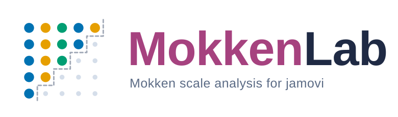

<p align="center">
  <picture>
    <source media="(prefers-color-scheme: dark)" srcset="docs/logo/mokkenlab-logo-dark.svg">
    
  </picture>
</p>

<p align="center">
  <a href="LICENSE"></a>
  
  
</p>

> **A jamovi module for Mokken scale analysis: do your items form a scale,
> which items belong together, and can you trust the order in which they
> measure the trait?**

MokkenLab brings the nonparametric item response theory of the
[mokken](https://CRAN.R-project.org/package=mokken) R package to
[jamovi](https://www.jamovi.org/), without writing a line of R. Like its
sibling modules [AssumptionsLab](https://github.com/ArchieJamDev/AssumptionsLab),
[FiabilityLab](https://github.com/ArchieJamDev/FiabilityLab) and
[EGAnetLab](https://github.com/ArchieJamDev/EGAnetLab), it does not stop at the
numbers: every option in the menu explains what it does and when to choose it,
and every result comes with a plain-language interpretation, the evidence
behind it and the next step to take.

---

## Contents

- [Why MokkenLab?](#why-mokkenlab)
- [Analyses](#analyses)
- [Supported Data](#supported-data)
- [Methodological Philosophy](#methodological-philosophy)
- [Installation](#installation)
- [Example Datasets](#example-datasets)
- [For Developers](#for-developers)
- [Roadmap](#roadmap)
- [Citation](#citation)
- [License & Author](#license--author)
- [Resumen en español](#resumen-en-español)

---

## Why MokkenLab?

Most scales are built on items that are ordinal, few in number and far from
normally distributed, yet are analysed with models that assume much more.
**Mokken scale analysis** (Mokken, 1971; Sijtsma & Molenaar, 2002) asks a
weaker and more honest question: do the items order respondents consistently
on one latent trait? It answers with scalability coefficients (*H*), checks
the assumptions that make sum scores meaningful (monotonicity, local
independence) and, under the double monotonicity model, whether the items
keep the same order of difficulty for every respondent (invariant item
ordering).

The mokken package implements all of this, but the decisions are many and
easy to get wrong: which lower bound for *H*, which confidence interval, how
to treat violations, when a scale is "strong" or merely "weak". MokkenLab puts
the whole toolkit in jamovi's point-and-click interface:

- **A menu of decisions, not a wall of defaults.** Lower bounds, confidence
  intervals, selection algorithms, minimum group sizes and every other choice
  is an explicit option, each with an explanatory paragraph.
- **Guidance with every table.** A key-findings summary at the top, a short
  guide before each result and an interpretation after it, in English or
  Spanish.
- **Configurable item response function plots.** Monotonicity, invariant item
  ordering, rest-score and P-matrix plots with colorblind-safe palettes and
  control over items, confidence bands, size and layout.
- **Native citations.** Every method-backed table cites its own source in
  jamovi's numbered reference format.

---

## Analyses

MokkenLab is organised as a menu of decisions. Each analysis is one entry in
the **Mokken Lab** menu, and each option inside it carries its own
explanation.

### Scaling

| Analysis | Question it answers | Status |
|---|---|---|
| **Mokken Scale Analysis** | How scalable are the item pairs (*H<sub>ij</sub>*), the items (*H<sub>i</sub>*) and the whole scale (*H*), with standard errors, Wald-based or range-preserving confidence intervals and tests against a lower bound, overall and by group? | ✅ 0.1.0 |
| **Reliability** | How reliable is the sum score (Molenaar-Sijtsma, alpha, lambda-2, LCRC)? | ✅ 0.1.0 (in Mokken Scale Analysis) |
| **Guttman-error outliers** | Which respondents answer far less consistently than the scale predicts? | ✅ 0.1.0 (in Mokken Scale Analysis) |
| **Bounds and norms** | What are the bounds of *H* for dichotomous items, and the norm statistics of the sum score with standard errors? | ✅ 0.1.0 (in Mokken Scale Analysis) |
| **Automated Item Selection** (AISP) | Into how many Mokken scales do the items split, with Mokken's procedure or a genetic algorithm, at one lower bound or across a sequence of them? | ✅ 0.1.0 |

### Model fit

| Analysis | Question it answers | Status |
|---|---|---|
| **Monotonicity** | Does the probability of endorsing each item rise with the rest score? | ✅ 0.1.0 (in Model Assumptions) |
| **Invariant item ordering** | Do the items keep the same order of difficulty for every respondent (manifest IIO, with backward item selection)? | ✅ 0.1.0 (in Model Assumptions) |
| **Nonintersection** | Do item step response functions cross (rest-score and P-matrix methods)? | ✅ 0.1.0 (in Model Assumptions) |
| **Local independence** | Are some item pairs more related than one trait explains (conditional association)? | ✅ 0.1.0 (in Model Assumptions) |

### Two-level data

| Analysis | Question it answers | Status |
|---|---|---|
| **Two-Level Mokken Scale Analysis** | With raters nested in subjects (students rating their teacher), how scalable are the items within and between subjects, and what is their ratio? | 🔄 In development |

---

## Supported Data

MokkenLab analyses **items measured on the same respondents** (or, for
two-level analysis, items rated by several raters about the same subject):

| Item type | Examples |
|---|---|
| **Dichotomous** | Right/wrong test items, yes/no symptoms |
| **Polytomous ordinal** | Likert items, rating scales |

Negatively worded items can be reversed inside the analysis, and missing
values are handled by an explicit option rather than silently.

---

## Methodological Philosophy

1. **Decisions, not defaults.** Every choice is visible and explained; the
   module never hides a decision from the user.
2. **Evidence over a single coefficient.** An *H* above 0.3 is a claim that
   needs support: confidence intervals, assumption checks and item ordering.
3. **Explain, then report.** Guides before results, interpretations after,
   in the language of the report.
4. **Fidelity to mokken.** MokkenLab calls the mokken package; it does not
   reimplement it.
5. **Transparent failure.** When something cannot be computed, the output
   says what and why, instead of silently dropping it.

---

## Installation

MokkenLab is not yet in the official jamovi Library. Until then, install it
from source:

```r
install.packages("jmvtools", repos = c("https://repo.jamovi.org", "https://cran.r-project.org"))
jmvtools::install()   # from the repository root, with jamovi installed
```

The **Mokken Lab** menu then appears in jamovi's Analyses ribbon.

---

## Example Datasets

MokkenLab ships four public datasets from the mokken package. Open them from
jamovi's **⋮** → **Open** → **Data Library** → **Mokken Lab**.

| Dataset | What it lets you try |
|---|---|
| **Type D Scale DS14** (n = 541) | Fourteen 5-point items, two negatively worded, with real missing data, sex and age: scalability, AISP, groups |
| **Transitive reasoning** (n = 425) | Twelve dichotomous tasks across five school grades: bounds for dichotomous items, monotonicity, IIO |
| **Autonomy support** (259 students rating 14 teachers) | Seven 5-point items with students nested in teachers: two-level scalability |
| **Test for Reception of Grammar TROG** (n = 210) | Eighty dichotomous items in 20 clusters of four: the ordering structure of a long test |

---

## For Developers

```r
jmvtools::prepare()   # regenerate .h.R files from the YAML
jmvtools::install()   # build and install into jamovi
```

`data-raw/prepare_dataset.R` rebuilds the bundled datasets from the mokken
package.

---

## Roadmap

| Phase | Content | Status |
|---|---|---|
| 0 | Platform, Mokken Scale Analysis, AISP, Model Assumptions, datasets, icon | ✅ Done |
| 1 | Two-Level Mokken Scale Analysis | 🔄 In progress |
| 2 | Test suite and CI, validation against direct mokken calls | 🗓 Planned |
| 3 | Documentation (bibliography, architecture), release and jamovi Library submission | 🗓 Planned |

---

## Citation

If you use MokkenLab in your research, please cite the module and the mokken
package:

> Chacón Chacón, A. D. L. (2026). *MokkenLab: A jamovi module for Mokken
> scale analysis* (Version 0.1.0) [Computer software].
> https://github.com/ArchieJamDev/MokkenLab

> van der Ark, L. A. (2012). New developments in Mokken scale analysis in R.
> *Journal of Statistical Software, 48*(5), 1–27.
> https://doi.org/10.18637/jss.v048.i05

---

## License & Author

MokkenLab is released under the [GNU General Public License v3.0](LICENSE).

**Arquímedes De León Chacón Chacón**: Psychologist · Data Scientist ·
Research Methodologist. Project Founder and Lead Developer.
Universidad Católica Andrés Bello (UCAB), Caracas, Venezuela.
[ORCID](https://orcid.org/0000-0002-7014-7513)

Copyright © 2026 Arquímedes De León Chacón Chacón

---

## Resumen en español

**MokkenLab** es un módulo de jamovi para el análisis de escalas de Mokken
(teoría de respuesta al ítem no paramétrica) basado en el paquete de R
mokken. Permite estimar los coeficientes de escalabilidad (*H<sub>ij</sub>*,
*H<sub>i</sub>* y *H*) con errores estándar, intervalos de confianza y
pruebas frente a un límite inferior; seleccionar automáticamente los ítems en
escalas (procedimiento de Mokken o algoritmo genético); comprobar la
monotonicidad, el orden invariante de los ítems, la no intersección y la
independencia local; y obtener la fiabilidad, los casos atípicos por errores
de Guttman, los límites para ítems dicotómicos y las normas del puntaje
total. El análisis de Mokken de dos niveles (evaluadores anidados en sujetos)
está en desarrollo.

Trabaja con ítems dicotómicos y politómicos ordinales. Cada opción del menú
incluye un párrafo que explica qué hace y cuándo conviene elegirla, y los
resultados se acompañan de un resumen de hallazgos, guías e interpretaciones
en español o inglés. Incluye cuatro conjuntos de datos públicos del paquete
mokken para practicar.
